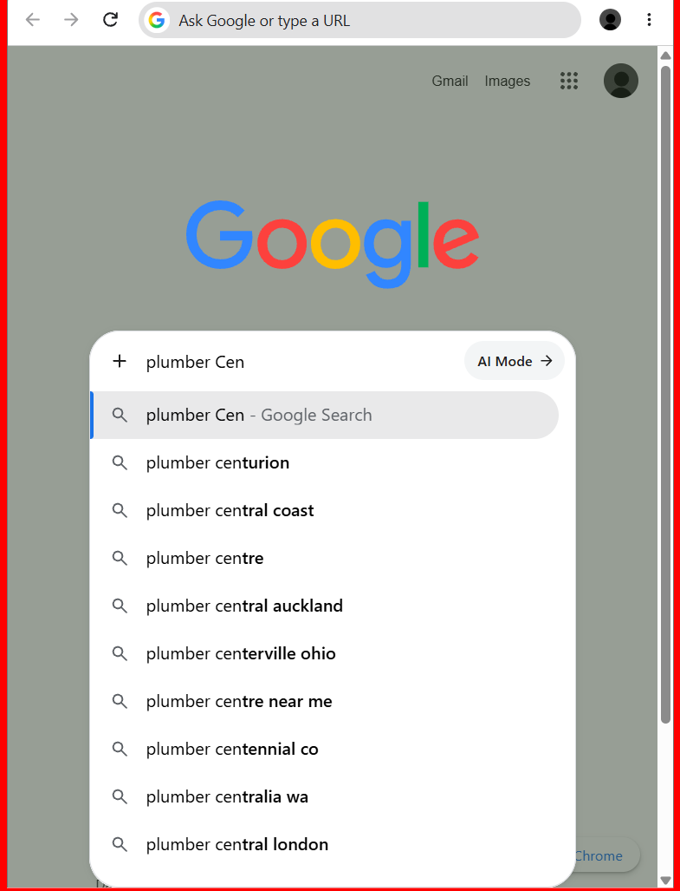
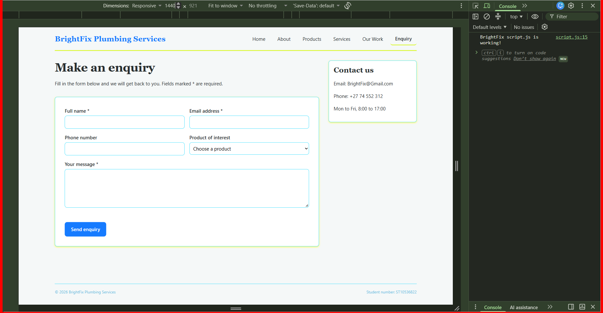
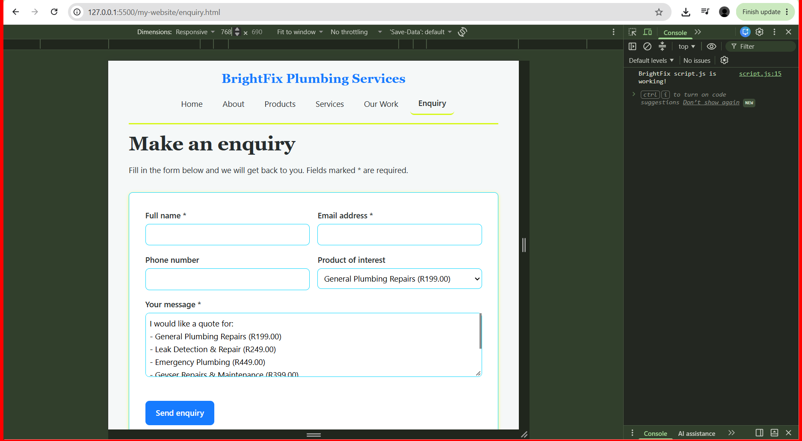
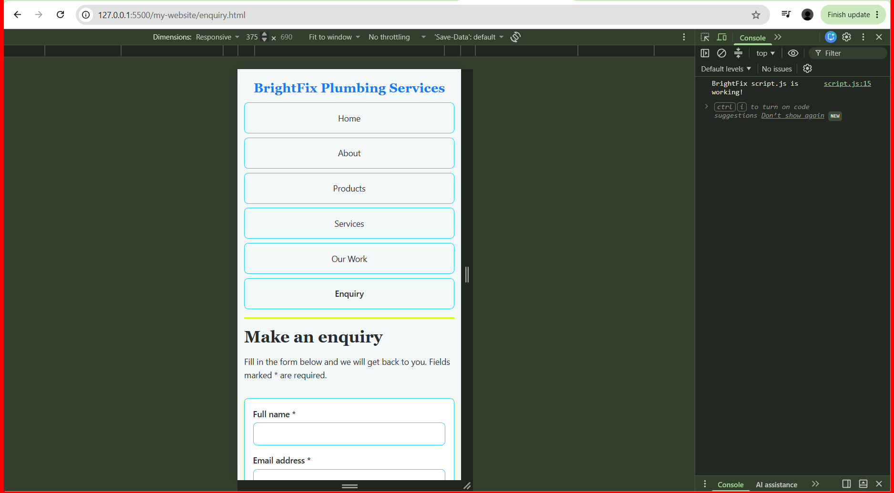
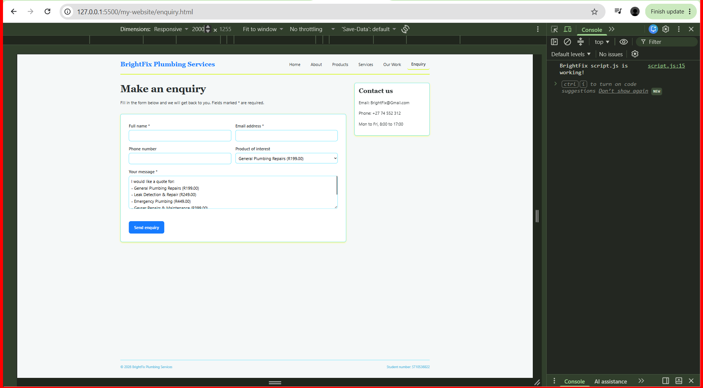
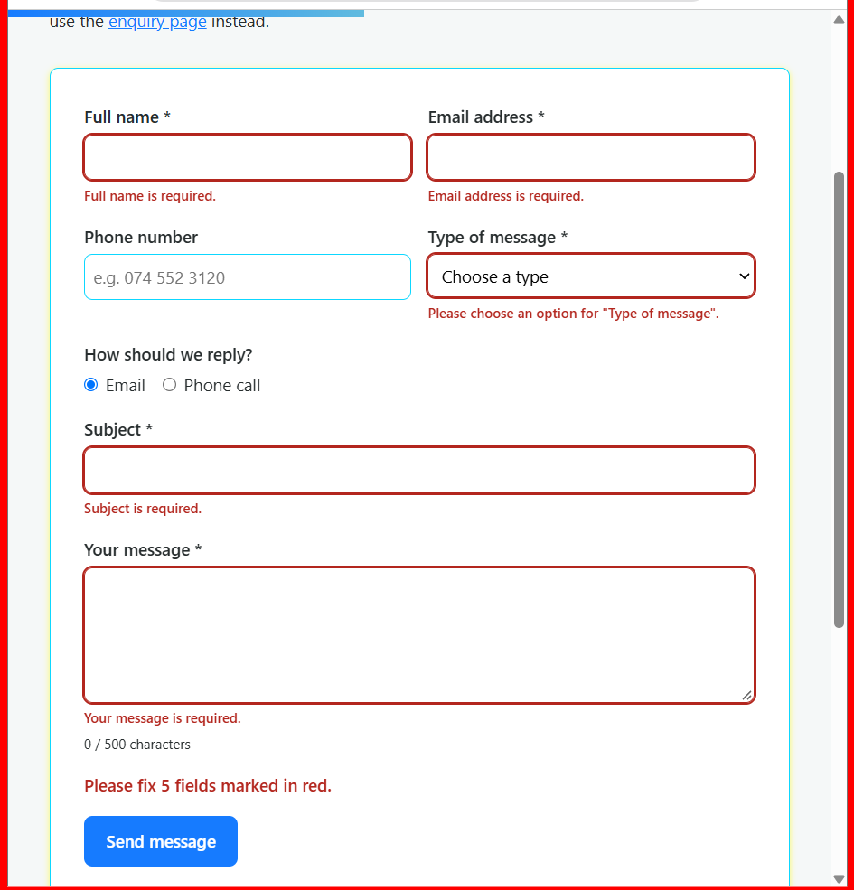
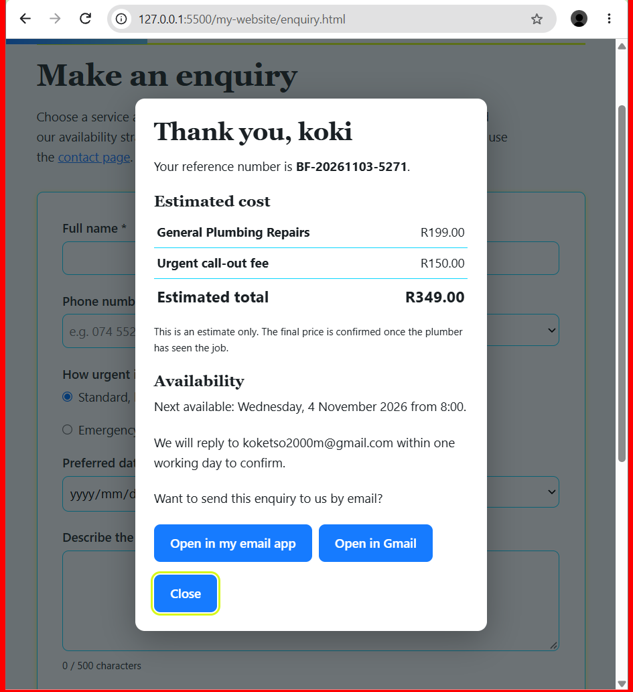
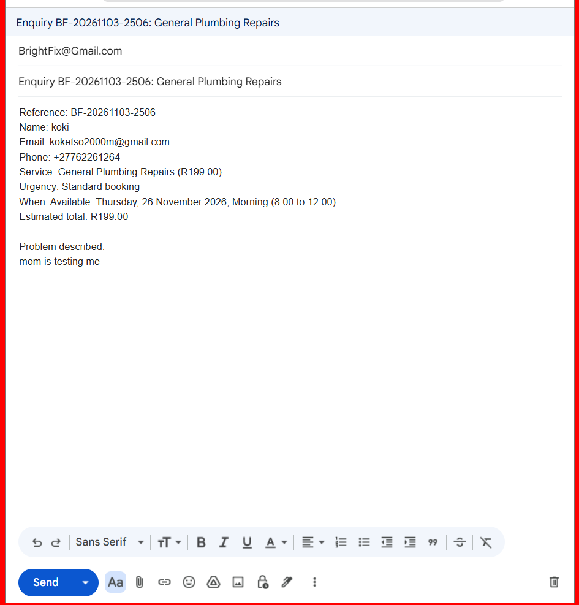

# BrightFix Plumbing Services – CSS, Responsive Design, JavaScript, Forms & SEO

**Student name:** Koketso  
**Student number:** ST10536822  
**Module:** WEDE5020

## 1. Stylesheet Overview

All pages link to one external stylesheet, `style.css`, using:

```html
<link rel="stylesheet" href="style.css">
```

**Naming convention:** lowercase kebab-case with BEM (`block__element--modifier`), e.g. `.site-nav__link--current`.

## 2. Styling Decisions

| Requirement | What I did | Where in `style.css` |
|---|---|---|
| 2.2 Base style | CSS reset, plus variables for colours, fonts and spacing in `:root` | Sections 1 and 2 |
| 2.3 Typography | `font-family`, `font-size`, `font-weight`, `line-height`, `letter-spacing`; type scale with a 1.25 ratio | Section 3 |
| 2.4 Layout | CSS Grid with `grid-template-areas` for the page; Flexbox for the header, nav and footer | Section 4 |
| 2.5 Visual styles | `color`, `background-color`, `border`, `box-shadow`; `:hover`, `:focus`, `:active` on links, buttons and cards | Section 5 |

## 3. Responsive Design

| Breakpoint | Width | Changes |
|---|---|---|
| Desktop | above 1024px | Two-column layout (main + sidebar), 3 cards across, horizontal nav |
| Tablet | 641px – 1024px | Single column, 2 cards across, base font 15px, centred nav |
| Mobile | 640px and below | Single column, 1 card across, base font 14px, vertical stacked nav, smaller headings |

- **Relative units (3.2):** `rem`/`em` for font sizes and spacing; `%` for widths and heights.
- **Responsive images (3.3):** `srcset` + `sizes` and the `<picture>` element, with `max-width: 100%` in CSS.

## 3A. JavaScript Enhancements

All JavaScript is in one file, `script.js`, linked at the bottom of every page with:

```html
<script src="script.js" defer></script>
```

The code runs inside `DOMContentLoaded`, and each feature checks that its page elements exist first, so one script can safely serve all pages. No frameworks were used (plain JavaScript).

| Requirement | Feature | Page | Section in `script.js` |
|---|---|---|---|
| Interactive elements: tabs | Residential / Commercial / Emergency tabs with arrow-key navigation (ARIA roles) | services.html | Section 2a |
| Interactive elements: accordion | FAQ built with `<details>`, plus Expand all / Collapse all buttons | services.html | Section 2b |
| Interactive elements: modals | Enquiry results popup and gallery lightbox (`<dialog>`) | enquiry.html, gallery.html | Sections 6 and 8 |
| Interactive maps | Leaflet map with 4 area markers, a 15 km service-area circle, layer toggles and a "Find my nearest area" button (Geolocation API) | Homepage.html | Section 5 |
| Animations and transitions | Scroll-reveal cards (IntersectionObserver), animated number counters (`requestAnimationFrame`), water-fill scroll progress bar, CSS tab and lightbox animations | All pages | Section 4 and `style.css` Section 10 |
| Advanced DOM manipulation | Product cards created from a JavaScript array, live search, price slider, sorting, "no results" message, quote basket saved with `localStorage`, enquiry dropdown and message auto-filled from the quote | products.html, enquiry.html | Section 3 |
| Gallery with lightbox | Filterable photo gallery built from an array, lightbox with Next / Previous, arrow keys, Esc and click-outside to close, fallback image for missing photos | gallery.html | Section 6 |
| Form validation | One shared validator (`getFieldError`, `showFieldError`, `setupValidation`) used by both forms | contact.html, enquiry.html | Section 7 |
| Processed response | Estimated cost and availability worked out from the visitor's answers | enquiry.html | Section 8 |
| Compiled email | Validated answers turned into an email the visitor can send | contact.html, enquiry.html | Section 9 |

### Accessibility and performance choices
- Animations are switched off for users who choose "reduce motion" (`prefers-reduced-motion`).
- Tabs, accordion, gallery, lightbox and forms all work with the keyboard.
- Real content is written in the HTML first (for example the counter numbers), so the page still makes sense if JavaScript fails.
- Gallery images use `loading="lazy"` so they load only when needed.
- Text is added with `textContent` instead of `innerHTML`, which avoids injecting unwanted code.
- Form errors are linked to their fields with `aria-invalid` and `aria-describedby`, and the error summary uses `role="alert"`.

### Libraries used
- Leaflet 1.9.4 (map library, https://leafletjs.com), loaded with Subresource Integrity hashes
- OpenStreetMap map tiles (© OpenStreetMap contributors)

## 3B. Form Functionality and Validation

There are two forms, with different purposes.

| | enquiry.html | contact.html |
|---|---|---|
| Purpose | Ask about a service and get a cost and availability response | Send a general message to the business |
| Fields | Name, email, phone, service, urgency, date, time, problem description | Name, email, phone, message type, reply method, subject, message |
| Form elements used | `input` (text, email, tel, date, radio), `select`, `textarea` | `input` (text, email, tel, radio), `select`, `textarea` |
| Result after validation | Popup with reference number, cost table and availability message | Email preview (To, Subject, Message) with three ways to send it |
| `action` attribute | `mailto:BrightFix@Gmail.com` | `mailto:BrightFix@Gmail.com` |

### Validation rules

| Check | Rule | How it is checked |
|---|---|---|
| Required fields | Name, email, service or message type, subject, message, date and time (standard bookings) | `required` attribute and JavaScript |
| Name | 2 to 60 characters, letters, spaces, hyphens and apostrophes only | `minlength`, `maxlength` and a regular expression |
| Email | Must look like `name@example.com` | `type="email"` and a stricter regular expression |
| Phone (optional) | South African format, e.g. `074 552 3120` or `+27 74 552 3120` | `pattern` attribute, reused by JavaScript |
| Subject | 3 to 80 characters | `minlength`, `maxlength` |
| Message | 10 to 500 characters, with a live character counter | `minlength`, `maxlength` |
| Date | Today up to 90 days ahead, and only a real date | `min`, `max` set by JavaScript and a `badInput` check |
| Urgent or emergency jobs | Date and time are hidden and no longer required | JavaScript toggles `required` |

The forms use `novalidate` so that the browser's pop-up bubbles are replaced by inline error messages placed under each field. Errors appear when a visitor leaves a field and disappear as soon as it is fixed. On submit, the first mistake receives focus and a summary says how many fields need fixing.

### How the enquiry response is worked out
- The service price comes from the same `products` array used on the Products page.
- An urgency fee is added: standard R0, urgent R150, emergency R300 (example business rules I chose).
- Availability depends on the urgency and the date: weekends are moved to the next working day for standard jobs, and urgent jobs are checked against the time of day.

### How the email is compiled
`compileEmail()` joins the validated answers into a plain-text body, then builds a `mailto:` link, a Gmail compose link and a copy-to-clipboard option. The recipient is read from the form's `action` attribute, so it is written in only one place.

### Limitations
- A site with no back end cannot send email by itself, so the visitor sends the compiled email from their own email app or Gmail.
- Client-side validation improves the experience but does not replace server-side checks. A live version would need validation on the server as well.
- The estimate only prices the service selected in the dropdown, not every item in the quote basket.

## 3C. Search Engine Optimisation (SEO)

### On-page SEO

| Requirement | What I did |
|---|---|
| Keyword research | Chose keywords from the services and location: "plumber Centurion", "plumbing services Pretoria", "geyser repairs", "blocked drain", "leak detection", "burst pipe repair", "emergency plumber", "plumbing quote". Checked them against Google's search suggestions (screenshot below). |
| Title tags and meta descriptions | Every page has a different keyword-based `<title>` (under about 60 characters) and a `<meta name="description">` of about 120 to 160 characters |
| Header tags | One `<h1>` per page, with `<h2>` for sections and cards, and `<h3>` below those |
| Image optimisation | Descriptive hyphenated file names, meaningful `alt` text, compressed images, `loading="lazy"` and `width` and `height` on large images |
| URL structure | Short, lowercase, descriptive file names (`products.html`, `services.html`) |
| Internal linking | Main menu and "Quick links" sidebar link every page to every other page; footer links on every page |
| Mobile-friendliness | Viewport meta tag, three breakpoints, relative units, tap-friendly stacked navigation |

### Off-page SEO

| Requirement | What I did |
|---|---|
| Social media | Open Graph tags (`og:title`, `og:description`, `og:type`, `og:locale`) so shared links look right; Facebook, Instagram and WhatsApp links in the footer (placeholders until real business pages exist) |
| Local SEO | Same name, address and phone details on every page; `Plumber` structured data (JSON-LD) on the homepage with the location, service areas and opening hours; Leaflet map of the service area |
| Backlinks (plan) | Google Business Profile; local directories such as Yellow Pages SA, Hello Peter and Cylex; Facebook and Instagram business profiles; links from suppliers and partners; partnerships with property managers and estate agents; helpful how-to guides that other sites can link to |

### Additional requests

| Requirement | What I did |
|---|---|
| `robots.txt` | Allows all crawlers, blocks the `screenshots` folder, and points to the sitemap |
| `sitemap.xml` | Lists all 7 pages with `lastmod` and `priority`. The web address is the placeholder `st10536822.github.io/brightfix-plumbing` until the site is published, then it must be replaced. |
| Page speed | `defer` on scripts, lazy-loaded images, compressed images, `preconnect` to the Leaflet host, image sizes set to avoid layout shifts |
| Security | Subresource Integrity hashes on the Leaflet files, `rel="noopener noreferrer"` on links that open a new tab, a referrer policy meta tag, `textContent` instead of `innerHTML`, input validation. HTTPS would be provided by the host when published. |

### Lighthouse results

| Run | Performance | SEO | Notes |
|---|---|---|---|
| First run | 72 | 91 | After adding meta descriptions and fixing headings |
| Final run | 100 | 100 | After image optimisation and the other fixes |




Tested with browser developer tools (F12 → device toolbar) and Live Server in VS Code.

### Desktop (1440px)


### Tablet (iPad – 768px)


### Mobile (iPhone SE – 375px)


### Other devices


### Form testing

| Test | Expected result | Result |
|---|---|---|
| Submit contact form empty | Red errors under each required field and a summary message | Pass |
| Name `John123` | Error about letters only | Pass |
| Email `bob@x` | Error asking for a valid email | Pass |
| Phone `123` | Phone format error | Pass |
| Valid contact form | Email preview with To, Subject and Message | Pass |
| Enquiry, standard booking on a weekday | Cost table and availability for that day | Pass |
| Enquiry, urgent | Date and time hidden, extra fee added | Pass |
| Enquiry, standard booking on a Saturday | Moved to next Monday | Pass |







### Iteration notes
- **Unclosed media query:** the `@media (prefers-color-scheme: dark)` block in `style.css` was missing a closing `}`, which trapped all the later styles (including the responsive breakpoints) inside it. I found it by reading the brackets and fixed it by adding the missing `}`.
- **Broken links:** the logo and sidebars linked to `index.html`, which does not exist. I changed them to `Homepage.html` and made sure only one menu item has the `--current` class on each page.
- **Duplicate HTML:** `enquiry.html` and `Homepage.html` had duplicate footers, scripts and closing tags. I removed the duplicates so each page has one `</body>` and one `script.js` link.
- **Map placement:** the map sat outside `<main>`, so the page grid pushed it below the footer. I moved it inside `<main>` and loaded the Leaflet script before `script.js`.
- **Map overflow and zoom:** an old fixed height on `.map-container` made the map spill out of its card, and scrolling the page zoomed the map out. I removed the fixed height and turned off scroll-wheel zoom until the map is clicked.
- **Page wider than the screen:** a very large hero image stretched the grid column and pushed the sidebar and menu off the edge. I changed the columns to `minmax(0, ...)` and limited the image height.
- **Missing banner image:** the Console showed a 404 for `banner-desktop.png` because the file name did not match. I corrected the name.
- **Duplicate menu link:** a find-and-replace added the Contact link twice on `contact.html` and skipped `enquiry.html`. I fixed both by hand and counted the matches to check.
- **Server stopped:** the pages showed `ERR_CONNECTION_REFUSED` because Live Server had stopped. Restarting it with "Go Live" fixed it.
- **Gallery photos showing the fallback image:** the Console showed 404 errors because the image paths in the `works` array did not match my file names. I corrected the paths and the real photos loaded.
- **Hard refresh:** I used Ctrl + Shift + R after each change so the browser did not show old cached files.

## 5. References

Agafonkin, V. (2023) *Leaflet: an open-source JavaScript library for mobile-friendly interactive maps*, version 1.9.4. Available at: https://leafletjs.com (Accessed: 1 November 2026).

OpenAI (2026) BrightFix Plumbing Service promotional banner [AI-generated image]. Created using ChatGPT image generation, 5 October.

OpenAI (2026) BrightFix Plumbing Service plumbing mascot [AI-generated image]. Created using ChatGPT image generation, 5 October.

OpenAI (2026) BrightFix Plumbing Service gallery photos [AI-generated images]. Created using ChatGPT image generation, [add the date you made them].

OpenStreetMap contributors (2026) *OpenStreetMap*. Available at: https://www.openstreetmap.org (Accessed: 1 November 2026).

Schema.org (2026) *Plumber*. Available at: https://schema.org/Plumber (Accessed: 3 November 2026).

Sitemaps.org (2026) *Sitemaps XML format*. Available at: https://www.sitemaps.org/protocol.html (Accessed: 3 November 2026).